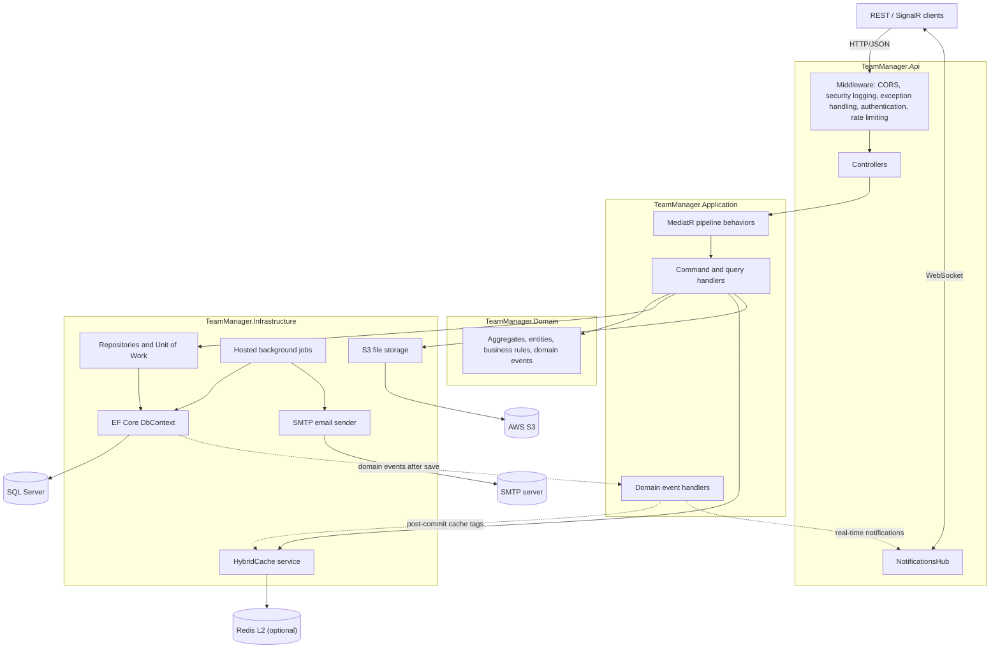
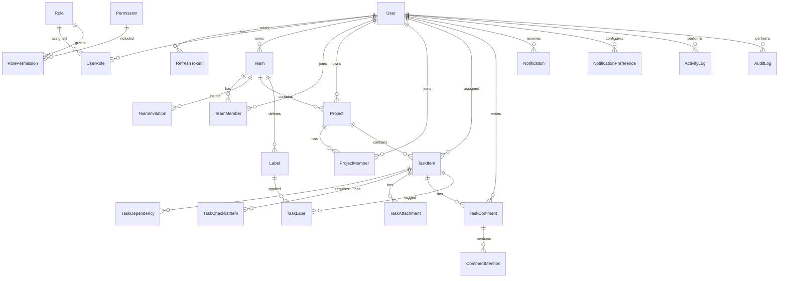
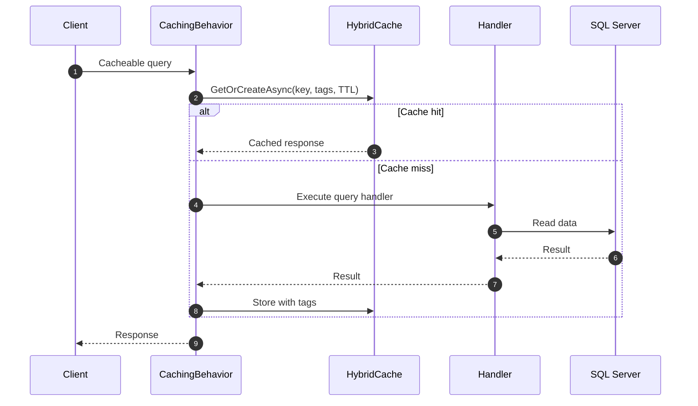

# TeamManager

A REST API for managing teams, projects, and tasks, built with ASP.NET Core 10 using Clean Architecture, CQRS, and SQL Server.

[](https://dotnet.microsoft.com/)
[](https://github.com/Sherif-Osama/Team-Manager-System/actions/workflows/ci.yml)

## Table of Contents

- [Project Overview](#project-overview)
- [Core Features](#core-features)
- [Architecture Overview](#architecture-overview)
- [Technology Stack](#technology-stack)
- [Repository Structure](#repository-structure)
- [Database Design](#database-design)
- [Authentication and Authorization](#authentication-and-authorization)
- [Caching Strategy](#caching-strategy)
- [API Overview](#api-overview)
- [Getting Started](#getting-started)
- [Configuration](#configuration)
- [Docker Support](#docker-support)
- [Testing Strategy](#testing-strategy)
- [CI/CD](#cicd)
- [Engineering Decisions](#engineering-decisions)
- [Known Limitations](#known-limitations)

## Project Overview

TeamManager is a backend API for organizing work across teams, projects, and tasks. It covers the full collaboration path: user accounts and authentication, team creation and invitations, project membership, task assignment and workflows, comments and mentions, checklists, attachments, notifications, and administrative role management.

The API is designed for a separate client application. No frontend is included in this repository. Browser access is restricted by a configured CORS allowlist, and notifications can be delivered in real time over SignalR.

**Primary use cases**

- Create a team, invite members by email, and manage their roles.
- Organize work into projects with schedules and project-level roles.
- Create, assign, prioritize, schedule, and track tasks through a defined status workflow.
- Coordinate work with dependencies, checklists, comments, mentions, labels, and attachments.
- Receive in-app notifications for assignments, mentions, comments, invitations, and task completion.
- Administer system roles, permissions, users, and audit logs.

**Engineering goals reflected in the implementation**

- Keep domain rules in the Domain layer and use-case orchestration in the Application layer.
- Enforce authorization consistently at endpoint, permission, team, project, and task scopes.
- Preserve data integrity with SQL Server constraints, transactions, and optimistic concurrency.
- Dispatch side effects (emails, cache invalidation, real-time notifications) without losing transactional consistency.
- Verify behavior with both isolated unit tests and end-to-end integration tests against a real SQL Server instance.

## Core Features

### Identity and Account Management

- **Registration** with email uniqueness among non-deleted users, display name (maximum 100 characters), and a minimum password length of 8 characters.
- **Email confirmation** using a one-hour, hashed token. Confirmation is required before creating teams, inviting members, and bootstrapping an administrator.
- **Account lockout** after 5 consecutive failed login attempts; the account remains locked for 15 minutes.
- **Profile management**: update display name, request an email change with confirmation, change password, deactivate the account, and delete the account.
- **Account protection rules**: a user who owns a non-deleted team or an unfinished project cannot delete their account, and the last SystemAdmin cannot deactivate or delete their account.
- **Deactivation effects**: refresh tokens are revoked, owned teams are deactivated, owned projects move to `OnHold`, and non-owner memberships are suspended. A successful login later reactivates the account and its suspended memberships.
- **Deletion semantics**: accounts are soft-deleted and refresh tokens are revoked. A separate daily job soft-deletes accounts that have remained inactive for 30 days, excluding owners of non-deleted teams or projects.

### Authentication and Sessions

- JWT access tokens with a default lifetime of 15 minutes.
- Opaque refresh tokens with a default lifetime of 7 days, stored only as SHA-256 hashes together with device information and IP address.
- Refresh-token rotation: each refresh issues a new token and revokes the previous one with a replacement reference.
- Logout revokes the supplied refresh token and is idempotent.
- Password reset uses a 30-minute, hashed token and always returns a generic response from the forgot-password endpoint.

### Team Management

- Create teams; the creator becomes the team Owner. Team names are unique among non-deleted teams.
- Update team details, activate/deactivate a team, and soft-delete a team.
- Ownership transfer to an active member; the previous owner becomes an Admin.
- Team soft deletion is rejected while the team still has projects that are not `Completed`.
- Team-scoped labels with case-insensitive unique names, hexadecimal colors, and tag-based cache invalidation.
- Team activity log for Owners, Admins, and Members.

### Invitations and Team Membership

- Invite users by email with a seven-day invitation token. Invitations prevent duplicate pending invitations for the same team and email.
- Accept or reject invitations; pending invitations expire automatically through a background job that runs every 10 minutes.
- Pending invitations are linked to a user account when a user registers with the invited email address.
- Team roles: `Owner`, `Admin`, `Member`, and `Viewer`. Owners cannot be added or removed through member management; ownership changes only through transfer.
- Change a member's role, remove a member, and record invitation/membership events in activity logs.
- Removing a member also removes their project memberships for projects in that team.

### Project Management

- Projects are created inside a team by the team Owner.
- Project names are unique per team among non-deleted projects.
- Project schedules validate that the due date is not earlier than the start date and that dates are not in the past.
- Project status workflow: `Active`, `OnHold`, `Completed`, and `Archived`.
- Project ownership transfer to an active member; the previous owner becomes an Admin.
- Project soft deletion is rejected while the project has active tasks (tasks that are not `Cancelled`).
- Project roles: `Owner`, `Admin`, `Member`, and `Viewer`.
- Project activity log for all project roles.

### Task Management

- Create tasks inside a project with title, description, optional assignee, dates, and priority (`Low`, `Medium`, `High`, `Urgent`).
- Assign or unassign active project members.
- Status workflow: `Todo` → `InProgress` → `InReview` → `Done`, with cancellation supported through soft deletion.
- Assignees have a restricted transition set; Owners and Admins can perform all domain-valid transitions.
- A task cannot move to `Done` while it has incomplete dependencies or incomplete checklist items.
- Task dependencies reject self-references, duplicates, and cycles. Cycle detection is implemented with a recursive SQL CTE.
- Rescheduling validates the due date against dependent tasks and the project schedule.
- Add or remove team-scoped labels on tasks.
- Paginated, filterable task listing per team with project, search, status, and priority filters.
- Personal task listing (`my tasks`) and soft deletion of tasks.

### Comments, Mentions, Checklists, and Attachments

- Add, edit, and delete task comments. Mentioned users are validated as active project members.
- List personal comments and personal mentions.
- Checklist items support ordering, completion, reopening, and removal. All checklist items must be completed before a task can be marked `Done`.
- Attachments are stored in AWS S3. Uploads are limited to 10 MB and the extensions `.pdf`, `.png`, `.jpg`, `.jpeg`, `.docx`, and `.xlsx`.
- Attachments are de-duplicated per task by SHA-256 content hash; downloads are streamed from S3.

### Notifications

- In-app notifications for task assignment, mentions, team invitations, new comments, and task completion.
- Per-user notification preferences per notification type; a missing preference means enabled.
- Unread count, paginated notification listing, mark-one-as-read, and mark-all-as-read.
- Real-time delivery over SignalR at `/hubs/notifications` using the `ReceiveNotification` event.
- Self-notifications are skipped for assignment, comment, and completion events.

### Audit and Activity Logs

- **Activity logs** capture team and project actions such as task creation, status changes, assignment, comments, invitations, membership changes, ownership transfers, and entity creation.
- **Audit logs** capture administrative actions: role assignment, role revocation, and user account deactivation, deletion, and reactivation.
- Audit logs are exposed through the admin API and protected by the `system.view_audit_log` permission.

### Administration and Role-Based Access Control

- Seeded roles: `SystemAdmin` and `User`.
- Seeded system permissions: `system.manage_projects`, `system.manage_users`, `system.view_audit_log`, `system.manage_roles`, and `system.manage_teams`.
- Role management: create, rename, delete, add permissions, and remove permissions.
- User administration: query users, assign roles, and revoke roles.
- Administrator bootstrap: assigns the SystemAdmin role to a confirmed, active user when no SystemAdmin exists, using a configured bootstrap secret.
- The last remaining SystemAdmin is protected from role revocation, deactivation, and deletion.

### Background Processing

- **Outbox processor** (every 10 seconds): delivers transactional emails with leases, batch processing (20 per batch), a 5-minute lease, up to 5 retries, and exponential backoff.
- **Invitation expiration** (every 10 minutes): marks expired pending invitations.
- **Inactive-user cleanup** (daily): soft-deletes accounts inactive for 30 days when they own no non-deleted teams or projects.
- **Refresh-token cleanup** (daily): deletes tokens that expired more than 30 days ago, excluding tokens referenced by a replacement chain.
- **Outbox retention** (daily): deletes processed or failed outbox messages older than 7 days.

## Architecture Overview

### Layers and Dependency Direction

The solution follows Clean Architecture with four production projects:

| Layer | Project | Responsibility |
|---|---|---|
| Domain | `TeamManager.Domain` | Aggregates, entities, enums, domain events, and business rules. No project dependencies. |
| Application | `TeamManager.Application` | Commands, queries, validators, pipeline behaviors, domain-event handlers, and abstractions. Depends on Domain. |
| Infrastructure | `TeamManager.Infrastructure` | EF Core persistence, repositories, migrations, caching, authentication services, S3 storage, SMTP email, and background jobs. Depends on Application. |
| Presentation | `TeamManager.Api` | Controllers, middleware, authentication configuration, rate limiting, Swagger, SignalR, and health checks. Depends on Application and Infrastructure. |

Dependencies point inward: Domain has no dependencies, Application depends only on Domain, and Infrastructure implements Application abstractions. The API composes the application and infrastructure at startup.

### CQRS and Request Flow

The Application layer is organized as vertical slices under `Features`, with commands and queries for each module. Controllers are thin: they construct a command or query and send it through MediatR.

Every request passes through the following pipeline behaviors, in order:

1. `ValidationBehavior` — runs FluentValidation validators and throws a `ValidationException` on failure.
2. `PermissionAuthorizationBehavior` — checks system permission codes via `IPermissionService`.
3. `ConfirmedEmailBehavior` — requires a confirmed email for marked requests.
4. `TeamAuthorizationBehavior` — checks the caller's active team role.
5. `ProjectAuthorizationBehavior` — checks the caller's active project role, with team-owner bypass.
6. `TaskAuthorizationBehavior` — resolves the task's project and applies the same project-role/team-owner rule.
7. `CachingBehavior` — serves queries that implement `ICacheableQuery` through the cache service.

Command handlers use repositories and the unit of work. Query handlers commonly project directly through the read-side `IApplicationDbContext` abstraction.

### Domain Model and Events

The Domain layer uses aggregate roots with encapsulated state transitions:

- `User`, `Team`, `Project`, `TaskItem`, and `Role` are aggregate roots.
- Child entities such as `TeamMember`, `TeamInvitation`, `ProjectMember`, `TaskComment`, `TaskChecklistItem`, `TaskAttachment`, and `TaskDependency` are modified through their aggregate. `Notification` and `NotificationPreference` are independent entities managed through the notification repository.
- Domain events are recorded by aggregates and stored in memory until the unit of work saves changes.

`TeamManagerDbContext.SaveChangesAsync` implements the dispatch flow:

1. Save entity changes.
2. Collect and clear domain events from tracked aggregates.
3. Publish each event as a `DomainEventNotification<T>` through MediatR.
4. Persist changes made by event handlers (for example, outbox messages and notification rows), then save again.
5. After the transaction commits, dispatch cache invalidation tags and real-time notifications.

Event handlers generate notifications, activity logs, audit logs, outbox email messages, membership lifecycle changes, task unassignment, and cache invalidation tags. If the transaction fails, pending post-commit dispatches are discarded.

### Transactions and the Outbox

- Standard writes use `SaveChangesAsync`, which wraps domain-event dispatch in a transaction when events are present.
- `ExecuteInTransactionAsync` uses `ReadCommitted`.
- `ExecuteInSerializableTransactionAsync` uses `Serializable` isolation with up to 3 retries for SQL Server deadlocks (error 1205), clearing the change tracker between attempts.
- Serializable transactions are used for operations with cross-entity invariants, including task creation, task status changes, project deletion, account deactivation/deletion, and administrator bootstrap.
- Emails are never sent inline. Email requests are written to `OutboxMessages` in the same transaction as the business change and delivered by a hosted processor. This provides at-least-once delivery.

### Architecture Diagram



## Technology Stack

| Responsibility | Technology | Version |
|---|---|---|
| Runtime | .NET / ASP.NET Core | `net10.0` |
| Web API | ASP.NET Core controllers | 10.0 |
| Application pipeline | MediatR | 14.2.0 |
| Validation | FluentValidation | 12.2.0 |
| Persistence | EF Core with SQL Server provider | 10.0.13 |
| Database | SQL Server | 2022 (integration tests) |
| Caching | Microsoft HybridCache | 10.11.0 |
| Distributed cache | Redis via `Microsoft.Extensions.Caching.StackExchangeRedis` | 10.0.14 |
| SignalR backplane | Redis via `Microsoft.AspNetCore.SignalR.StackExchangeRedis` | 10.0.15 |
| Authentication | JWT Bearer / `System.IdentityModel.Tokens.Jwt` | 10.0.13 / 8.23.0 |
| Password hashing | BCrypt.Net-Next | 4.2.0 |
| Real-time | ASP.NET Core SignalR | 10.0 |
| File storage | AWS SDK for .NET (S3) | 4.0.104.4 |
| Email | MailKit | 4.18.1 |
| API documentation | Swashbuckle.AspNetCore | 10.3.0 |
| Unit testing | xUnit / Moq | 2.9.3 / 4.21.0 |
| Integration testing | `Microsoft.AspNetCore.Mvc.Testing`, Testcontainers.MsSql, Respawn | 10.0.14 / 4.16.0 / 7.0.0 |
| Coverage collection | coverlet.collector | 6.0.4 / 10.1.0 |
| CI | GitHub Actions | — |
| Containerization | Docker, Docker Compose, Redis 7 Alpine | — |

Swagger is available in all environments.

## Repository Structure

```text
TeamManager/
├── TeamManager.Api/                 HTTP surface and application composition
│   ├── Authentication/              Current-user accessor
│   ├── Controllers/                 Attribute-routed controllers
│   ├── Extensions/                  Authentication, CORS, rate limiting, Swagger setup
│   ├── Hubs/                        SignalR hub and real-time notifier
│   ├── Middleware/                  Exception handling and security event logging
│   ├── Properties/                  Launch profiles
│   └── Program.cs                   Service registration and middleware pipeline
│
├── TeamManager.Application/         Use cases and application rules
│   ├── Abstractions/                Persistence, caching, authentication, storage, notifications
│   ├── Common/
│   │   ├── Behaviors/               MediatR pipeline behaviors
│   │   ├── Caching/                 Cache tags and cache invalidation dispatcher contract
│   │   ├── Events/                  Domain event notifications and handlers
│   │   ├── Exceptions/              Application exception types
│   │   └── Outbox/                  Outbox message types
│   ├── Features/                    Vertical slices by module
│   └── DependencyInjection.cs       MediatR, pipeline behaviors, validators
│
├── TeamManager.Domain/              Business domain model
│   ├── Common/                      Entity and aggregate base classes, domain events
│   ├── Entities/                    Users, teams, projects, tasks, roles, notifications, logs
│   ├── Enums/                       Status, role, priority, and notification enums
│   └── Exceptions/                  Domain exceptions
│
├── TeamManager.Infrastructure/      Technical implementations
│   ├── BackgroundJobs/              Outbox, invitation expiry, retention, cleanup
│   ├── Communication/               SMTP configuration and email sender
│   ├── Migrations/                  EF Core code-first migrations and model snapshot
│   ├── Persistence/
│   │   ├── Configurations/          Entity mappings, indexes, constraints, seed data
│   │   ├── Outbox/                  Outbox writer
│   │   └── Repositories/            Repository implementations
│   ├── Services/                    Auth, caching, notifications, permissions, activity/audit
│   ├── Storage/                     S3 file storage
│   └── DependencyInjection.cs       Infrastructure service registration
│
├── TeamManager.UnitTest/            Isolated unit tests
├── TeamManager.IntegrationTest/     End-to-end API tests with Testcontainers
├── Dockerfile                       Multi-stage production image
├── docker-compose.yml               API and Redis services
├── TeamManager.slnx                 Solution file
└── .github/workflows/ci.yml         GitHub Actions CI workflow
```

## Database Design

The application uses SQL Server with EF Core code-first migrations. The model contains 24 mapped tables and 29 migrations; the latest migration is `AddTeamsCreatedAtUtcIndex`.

### Entity Model

| Aggregate / Area | Tables | Purpose |
|---|---|---|
| Identity | `Users`, `RefreshTokens`, `Roles`, `Permissions`, `UserRoles`, `RolePermissions` | Accounts, sessions, roles, and permissions. |
| Teams | `Teams`, `TeamMembers`, `TeamInvitations`, `Labels` | Team lifecycle, membership, invitations, and labels. |
| Projects | `Projects`, `ProjectMembers` | Project lifecycle and project-level membership. |
| Tasks | `Tasks`, `TaskDependencies`, `TaskLabels`, `TaskChecklistItems`, `TaskAttachments`, `TaskComments`, `CommentMentions` | Task state, dependencies, labels, checklists, attachments, and discussions. |
| Notifications | `Notifications`, `NotificationPreferences` | In-app notifications and per-type preferences. |
| Observability | `ActivityLogs`, `AuditLogs` | Team/project activity and administrative audit trail. |
| Messaging | `OutboxMessages` | Transactional email outbox with lease and retry metadata. |

### Constraints and Indexes

The schema enforces important invariants at the database level:

- **Filtered unique indexes** preserve uniqueness while soft-deleted rows remain in the table:
  - user email (`DeletedAtUtc IS NULL`);
  - team name (`DeletedAtUtc IS NULL`);
  - project name per team (`DeletedAtUtc IS NULL`);
  - pending team invitation per team and email (`Status = 1`).
- **Occupied membership uniqueness**: a user can have at most one active or suspended membership per team and per project, enforced by filtered unique indexes.
- **Other unique constraints**: role name, permission code, refresh-token hash, invitation-token hash, label name per team, task dependency pair, checklist sort order per task, and attachment file hash per task.
- **Check constraints** cover valid enum ranges, date ranges (`DueDate >= StartDate`), no self-referencing task dependencies, positive attachment sizes, non-negative failed login attempts, and hexadecimal label colors.
- **Indexes for common reads** include team creation date, project status per team, task status per project, task assignee/status, due dates, unread notifications, activity logs by team/project and date, audit logs by entity and date, and outbox processing state.
- **RowVersion** optimistic-concurrency tokens are configured on `User`, `Team`, `TeamMember`, `TeamInvitation`, `Project`, `ProjectMember`, `TaskItem`, and `RefreshToken`.

### Concurrency and Soft Deletes

- Concurrent updates surface as `DbUpdateConcurrencyException` and are mapped to HTTP `409 Conflict`.
- Soft deletes use a `DeletedAtUtc` column on users, teams, projects, and tasks. Repositories explicitly filter deleted rows; there are no EF Core global query filters.
- Task deletion sets the task status to `Cancelled` and records the deletion timestamp.
- Filtered indexes keep unique constraints effective only for live rows.

### Migrations and Seed Data

- Migrations live in `TeamManager.Infrastructure/Migrations`.
- The API does not apply migrations automatically at startup; apply them explicitly or through the test harness.
- Seed data creates the `SystemAdmin` and `User` roles and the five system permissions, with all five permissions granted to `SystemAdmin`.

### Entity-Relationship Diagram

Simplified relationship view; join and configuration tables retain the same keys.



## Authentication and Authorization

### Tokens and Credentials

| Credential | Format | Lifetime | Storage |
|---|---|---|---|
| Access token | JWT, HMAC-SHA256 | 15 minutes (configurable) | Never persisted |
| Refresh token | 64 random bytes, Base64 | 7 days (configurable) | SHA-256 hash only |
| Email confirmation token | 32 random bytes, Base64 | 1 hour | SHA-256 hash only |
| Password reset token | 32 random bytes, Base64 | 30 minutes | SHA-256 hash only |
| Team invitation token | 32 random bytes, Base64 | 7 days | SHA-256 hash only |

- Passwords are hashed with BCrypt (`EnhancedHashPassword`, work factor 12).
- JWT validation checks issuer, audience, lifetime, and signing key with zero clock skew. The signing key is not committed and must be supplied through configuration.
- The JWT contains the user ID, email, and role claims. `MapInboundClaims` is disabled.
- SignalR accepts the access token from the `access_token` query string only for the `/hubs/notifications` path.
- The notifications hub uses a Redis backplane when `ConnectionStrings:Redis` is configured, so notifications reach clients connected to any API replica. Without Redis, connection tracking is in-process.

### Authorization Layers

1. **Endpoint authentication** — a fallback policy requires an authenticated user for every endpoint; public endpoints opt out with `[AllowAnonymous]`.
2. **Role-based checks** — administrator user-management endpoints require the `SystemAdmin` role at the controller level.
3. **Permission-based checks** — `PermissionAuthorizationBehavior` evaluates system permission codes from cached role assignments.
4. **Team-scoped checks** — `TeamAuthorizationBehavior` verifies an active team membership with one of the required team roles.
5. **Project-scoped checks** — `ProjectAuthorizationBehavior` verifies an active project membership with one of the required project roles. An active team Owner is allowed even without a project membership.
6. **Task-scoped checks** — `TaskAuthorizationBehavior` resolves the task's project and applies project roles or the team-owner bypass.
7. **Confirmed-email checks** — `ConfirmedEmailBehavior` gates team creation, member invitations, and administrator bootstrap.

### Role Model

| Scope | Roles | Notes |
|---|---|---|
| System | `SystemAdmin`, `User` | `SystemAdmin` holds the five system permissions by seed data. Custom roles can be created and assigned permissions. |
| Team | `Owner`, `Admin`, `Member`, `Viewer` | Owner is unique per team and changed only through ownership transfer. |
| Project | `Owner`, `Admin`, `Member`, `Viewer` | Owner is unique per project. Team Owners bypass project role checks. |

Representative authorization rules:

- Team update, ownership transfer, activation, deactivation, and deletion require the team `Owner` role.
- Team member, invitation, and label management require `Owner` or `Admin`.
- Project creation requires the team `Owner` role.
- Project update, schedule, status, deletion, and ownership transfer require the project `Owner` role.
- Project membership management requires the project `Owner` or `Admin` role.
- Task creation, assignment, priority changes, rescheduling, label changes, dependencies, and deletion require the project `Owner` or `Admin` role.
- Task title/description updates require the project `Owner` role.
- Task status changes, comments, and checklist changes allow `Owner`, `Admin`, or `Member`.
- Read access to projects, tasks, comments, checklists, dependencies, and attachments allows all project roles, including `Viewer`.
- System administration endpoints require the relevant permission code and, for user-management endpoints, the `SystemAdmin` role.

### Rate Limiting

Rate limiting uses sliding-window limiters with 6 segments per window. Rejected requests receive `429 Too Many Requests` as `application/problem+json` with a `Retry-After` header when available.

| Scope | Default limit |
|---|---|
| Global per IP | 300 requests / 60 seconds |
| Global per authenticated user | 120 requests / 60 seconds |
| `AuthLogin` | 5 requests / 60 seconds |
| `AuthRegister` | 5 requests / 3600 seconds |
| `AuthRefresh` | 30 requests / 60 seconds |
| `AuthForgotPassword` | 3 requests / 900 seconds |
| `AuthResetPassword` | 5 requests / 900 seconds |

The global limiter chains the per-IP and per-user partitions. Authentication policies partition by client IP. Rate limiter state is in-process.

### Additional Security Measures

- CORS origins are validated at startup and must be absolute HTTP/HTTPS origins without wildcards, paths, queries, or fragments.
- Validation failures return `ValidationProblemDetails`; domain and authorization failures are mapped to consistent `ProblemDetails` responses.
- HTTP 401 and 403 responses are logged as security events with reason, method, path, user ID, IP address, and trace ID.
- Unhandled exceptions return a generic error body; details are logged server-side.
- The bootstrap secret and JWT signing key are read from configuration and are not committed.
- SMTP credentials and AWS credentials are supplied externally.

## Caching Strategy

### Cache Provider

The application uses `HybridCache`:

- **L1** — in-process memory cache, with a local expiration of one minute.
- **L2** — Redis when `ConnectionStrings:Redis` is configured; otherwise an in-memory distributed cache. The Redis instance name is `teammanager:`.

Only queries implementing `ICacheableQuery` pass through `CachingBehavior`. Currently these are the team label queries:

| Query | Key | TTL | Tags |
|---|---|---|---|
| `GetLabelsQuery` | `teammanager:labels:team:{teamId}:search:{search}:page:{page}:pageSize:{pageSize}` | 30 minutes | `TeamLabels(teamId)` |
| `GetLabelByIdQuery` | `teammanager:labels:team:{teamId}:label:{labelId}` | 30 minutes | `TeamLabels(teamId)` |

Authorization and permission checks use the same cache service:

| Cached value | Key | TTL | Tags |
|---|---|---|---|
| Team authorization decision | `teammanager:auth:team:{teamId}:user:{userId}` | 5 minutes | `TeamAuthorization(teamId)`, `UserAuthorization(userId)` |
| Project authorization decision | `teammanager:auth:project:{projectId}:user:{userId}` | 5 minutes | `ProjectAuthorization(projectId)`, `UserAuthorization(userId)` |
| User permission codes | `teammanager:permissions:user:{userId}:codes` | 20 minutes | `UserPermissions(userId)`, `AllUserPermissions` |

### Invalidation

Domain-event handlers enqueue cache tags when relevant state changes:

- label changes → `TeamLabels(teamId)`;
- team membership and ownership changes → `TeamAuthorization(teamId)` and affected `UserAuthorization(userId)` tags;
- project membership and ownership changes → `ProjectAuthorization(projectId)` and affected `UserAuthorization(userId)` tags;
- role assignment, revocation, and role-permission changes → `UserPermissions(userId)` or `AllUserPermissions`.

`SaveChangesAsync` dispatches queued tags after the transaction commits by calling `RemoveByTagAsync`. Invalidation is best-effort: a failed invalidation is logged and not retried, and the entry remains until its TTL expires.

### Cache Flow



## API Overview

### Conventions

- All routes are attribute-routed and case-insensitive.
- Controllers are protected with `[Authorize]`; public endpoints use `[AllowAnonymous]`.
- JSON uses camelCase property names. Enum values are serialized and accepted as numbers.
- Date-only values use ISO `yyyy-MM-dd`; timestamps use UTC ISO 8601.
- List queries accept `page` (default 1) and `pageSize` (default 20) and return `{ items, totalCount, page, pageSize }`.
- FluentValidation failures return HTTP 400 with `ValidationProblemDetails`, with errors keyed by property name.
- Domain, authorization, and concurrency failures return `application/problem+json` with a status, title, detail, and instance.

### Endpoint Groups

| Group | Base route | Representative operations |
|---|---|---|
| Authentication | `/api/authentication` | Register, login, refresh, logout, current identity, forgot/reset password |
| Self-service users | `/api/users` | Profile, email change and confirmation, password change, deactivate, delete |
| Teams | `/api/teams` | Create, update, lookup, list, activate/deactivate, delete, ownership transfer, labels, activity |
| Team members | `/api/teammembers/{teamId}/members` | Add, list, get, change role, remove |
| Team invitations | `/api/teaminvitations` | Invite, accept, reject, cancel, list by team/email/current user |
| Projects | `/api/projects` | Update, schedule, status, ownership, delete, lookup, list, activity |
| Project creation | `/api/teams/{teamId}/projects` | Create a project in a team |
| Project members | `/api/projectmembers` | Add, list, current memberships, change role, remove |
| Tasks | `/api/tasks` | Update, status, schedule, priority, assignee, delete, my tasks |
| Task creation / team listing | `/api/projects/{projectId}/tasks`, `/api/teams/{teamId}/tasks` | Create a task; filter and page tasks across a team |
| Task comments | `/api/tasks/{taskId}/comments` | Add, edit, delete, list; personal comments and mentions |
| Task checklist | `/api/tasks/{taskId}/checklist` | Add, complete, reopen, remove, list |
| Task dependencies | `/api/tasks/{taskId}/dependencies` | Add, remove, list |
| Task attachments | `/api/taskattachments/{taskId}/attachments` | Upload, list, download, delete |
| Notifications | `/api/notifications` | List, unread count, mark read, read all, preferences |
| Administration | `/api/admin` | Bootstrap, users, roles, permissions, audit logs |
| Health | `/health` | Anonymous health check |
| Real-time | `/hubs/notifications` | SignalR hub; `ReceiveNotification` event |

### Examples

**Register a user**

```http
POST /api/authentication/register
Content-Type: application/json

{
  "email": "jane@example.com",
  "displayName": "Jane Doe",
  "password": "P@ssword1234"
}
```

```http
HTTP/1.1 201 Created
Content-Type: application/json

{
  "id": "3f2504e0-4f89-41d3-9a0c-0305e82c3301"
}
```

**Log in**

```http
POST /api/authentication/login
Content-Type: application/json

{
  "email": "jane@example.com",
  "password": "P@ssword1234"
}
```

```json
{
  "accessToken": "<jwt>",
  "refreshToken": "<opaque-refresh-token>"
}
```

**Create a task in a project**

```http
POST /api/projects/7c9e6679-7425-40de-944b-e07fc1f90ae7/tasks
Authorization: Bearer <access-token>
Content-Type: application/json

{
  "title": "Implement invitation emails",
  "description": "Queue invitation emails through the outbox.",
  "assigneeUserId": "3f2504e0-4f89-41d3-9a0c-0305e82c3301",
  "startDate": "2026-11-10",
  "dueDate": "2026-11-20",
  "priority": 2
}
```

The response is `201 Created` with the numeric task ID in the body and a `Location` header for the task resource.

**List tasks for a team**

```http
GET /api/teams/0f8fad5b-d9cb-469f-a165-70867728950e/tasks?status=1&priority=2&page=1&pageSize=20
Authorization: Bearer <access-token>
```

```json
{
  "items": [
    {
      "id": 42,
      "projectId": "7c9e6679-7425-40de-944b-e07fc1f90ae7",
      "projectName": "Platform",
      "assigneeUserId": "3f2504e0-4f89-41d3-9a0c-0305e82c3301",
      "assigneeUserName": "Jane Doe",
      "title": "Implement invitation emails",
      "description": "Queue invitation emails through the outbox.",
      "status": 1,
      "priority": 2,
      "createdBy": "3f2504e0-4f89-41d3-9a0c-0305e82c3301",
      "creatorName": "Jane Doe",
      "startDate": "2026-11-10",
      "dueDate": "2026-11-20",
      "completedAtUtc": null,
      "createdAtUtc": "2026-11-08T10:00:00Z",
      "updatedAtUtc": null,
      "labels": []
    }
  ],
  "totalCount": 1,
  "page": 1,
  "pageSize": 20
}
```

### Error Responses

Validation failure:

```json
{
  "errors": {
    "Email": ["Email format is invalid."]
  },
  "status": 400,
  "title": "Validation failed",
  "instance": "/api/authentication/register"
}
```

Other failures use Problem Details:

```json
{
  "status": 409,
  "title": "Conflict",
  "detail": "A team with the name 'Alpha Team' already exists.",
  "instance": "/api/teams"
}
```

| Status | Meaning |
|---|---|
| `400` | Validation failure, invalid domain operation, or inactive project |
| `401` | Missing/invalid credentials or authentication |
| `403` | Authenticated but not authorized |
| `404` | Requested resource was not found |
| `409` | Business conflict, duplicate resource, or optimistic-concurrency conflict |
| `423` | Account locked |
| `429` | Rate limit exceeded |
| `500` | Unhandled server error; details are logged and not returned |

### API Documentation

Swagger is available at `/swagger` in all environments. The Swagger definition includes a Bearer security scheme for authorized requests.

## Getting Started

### Prerequisites

| Requirement | Purpose |
|---|---|
| .NET 10 SDK | Build and run the solution. |
| SQL Server | Primary database. A local instance or container is sufficient. |
| Docker (optional) | Run the integration tests; Testcontainers starts SQL Server. |
| Redis (optional) | Distributed L2 cache and SignalR backplane. Without it, an in-memory distributed cache and in-process SignalR connection tracking are used. |
| AWS credentials profile | Required for attachment upload/download through S3. |
| SMTP account | Required for email delivery (confirmation, invitations, password reset, account emails). |

### Setup

1. Clone the repository and restore dependencies:

   ```bash
   git clone https://github.com/Sherif-Osama/Team-Manager-System.git
   cd Team-Manager-System
   dotnet restore TeamManager.slnx
   ```

2. Supply the required configuration. The repository does not contain the JWT signing key, SMTP credentials, or production secrets. User secrets are the recommended local option:

   ```bash
   dotnet user-secrets set "Jwt:Key" "<random-signing-key-of-at-least-32-bytes>" --project TeamManager.Api
   dotnet user-secrets set "ConnectionStrings:DefaultConnection" "Server=localhost;Database=TeamManager;Trusted_Connection=True;TrustServerCertificate=True" --project TeamManager.Api
   dotnet user-secrets set "Email:Username" "<smtp-username>" --project TeamManager.Api
   dotnet user-secrets set "Email:Password" "<smtp-password>" --project TeamManager.Api
   dotnet user-secrets set "Email:FromEmail" "<sender@example.com>" --project TeamManager.Api
   dotnet user-secrets set "Bootstrap:AdminSecret" "<bootstrap-secret>" --project TeamManager.Api
   ```

3. Configure an AWS credentials profile named by `FileStorage:ProfileName` (the default configuration expects `teammanager-dev`) if attachments are needed.

4. Apply the database migrations. The API does not run migrations at startup:

   ```bash
   dotnet tool install --global dotnet-ef
   dotnet ef database update --project TeamManager.Infrastructure --startup-project TeamManager.Api
   ```

### Run the API

```bash
dotnet run --project TeamManager.Api
```

The default `http` launch profile listens on `http://localhost:5062` and opens Swagger in the browser. The Swagger UI is also available at `/swagger`.

### Bootstrap the First Administrator

The bootstrap endpoint requires an authenticated user with a confirmed email, a valid bootstrap secret, and no existing SystemAdmin:

1. Register a user with `POST /api/authentication/register`.
2. Confirm the email using the link sent by the API.
3. Log in with `POST /api/authentication/login`.
4. Call `POST /api/admin/bootstrap` with the access token:

   ```json
   {
     "email": "jane@example.com",
     "secret": "<Bootstrap:AdminSecret value>"
   }
   ```

### Run the Tests

```bash
# Unit tests (no external dependencies)
dotnet test TeamManager.UnitTest/TeamManager.UnitTest.csproj

# Integration tests (requires a running Docker daemon)
dotnet test TeamManager.IntegrationTest/TeamManager.IntegrationTest.csproj
```

## Configuration

Configuration is read from standard ASP.NET Core sources: `appsettings.json`, `appsettings.{Environment}.json`, environment variables, user secrets, and command-line arguments. Environment variables use double underscores for nested keys (for example, `ConnectionStrings__DefaultConnection`).

### Core Settings

| Key | Description | Required | Default / example |
|---|---|---|---|
| `ConnectionStrings:DefaultConnection` | SQL Server connection string | Yes | `Server=localhost;Database=TeamManager;Trusted_Connection=True;TrustServerCertificate=True` |
| `ConnectionStrings:Redis` | Redis connection for the L2 cache and the SignalR backplane | No | `localhost:6379`; omitted means in-memory distributed cache and in-process SignalR connection tracking |
| `Jwt:Key` | HMAC-SHA256 signing key | Yes | Not present in the repository; provide via secrets or environment |
| `Jwt:Issuer` | Expected JWT issuer | Yes | `TeamManager.Api` |
| `Jwt:Audience` | Expected JWT audience | Yes | `TeamManager.Client` |
| `Jwt:ExpirationMinutes` | Access-token lifetime in minutes | No | `15` |
| `Jwt:RefreshTokenExpirationDays` | Refresh-token lifetime in days | No | `7` |
| `Email:Host` | SMTP server host | Yes for email | `smtp.gmail.com` |
| `Email:Port` | SMTP server port | Yes for email | `587` |
| `Email:Username` | SMTP user name | Yes for email | Not present in the repository |
| `Email:Password` | SMTP password | Yes for email | Not present in the repository |
| `Email:FromName` | Sender display name | No | `Team-Manager` |
| `Email:FromEmail` | Sender email address | Yes for email | Not present in the repository |
| `Email:UseSsl` | Use STARTTLS when `true`; otherwise no encryption | No | `true` |
| `AppUrl:BaseUrl` | Base URL used in email links | Yes for email | `https://team-manager-app.com` |
| `Bootstrap:AdminSecret` | Secret required by the bootstrap endpoint | Yes to bootstrap | Not present in the repository; provide via secrets or environment |
| `FileStorage:BucketName` | S3 bucket for attachments | Yes for attachments | A bucket name |
| `FileStorage:Region` | AWS region for S3 | Yes for attachments | `eu-north-1` |
| `FileStorage:ProfileName` | AWS credentials profile name | Yes for attachments | `teammanager-dev` |
| `Cors:AllowedOrigins` | Allowed browser origins | Yes for browser clients | `["https://team-manager-app.com", "http://localhost:5173"]` |
| `AllowedHosts` | ASP.NET Core host filtering | No | `*` |

`FileStorage:Provider` also exists in configuration, but the registered storage implementation is always S3. `FileStorage:MaxFileSizeBytes` and `FileStorage:AllowedExtensions` are bound to options, but upload validation currently uses fixed values in the validator (10 MB and the six extensions listed above).

### Rate-Limiting Settings

| Key | Default |
|---|---|
| `RateLimiting:Global:PerIpLimit` | `300` |
| `RateLimiting:Global:PerIpWindowSeconds` | `60` |
| `RateLimiting:Global:PerUserLimit` | `120` |
| `RateLimiting:Global:PerUserWindowSeconds` | `60` |
| `RateLimiting:Authentication:Login:PermitLimit` | `5` |
| `RateLimiting:Authentication:Login:WindowSeconds` | `60` |
| `RateLimiting:Authentication:Register:PermitLimit` | `5` |
| `RateLimiting:Authentication:Register:WindowSeconds` | `3600` |
| `RateLimiting:Authentication:Refresh:PermitLimit` | `30` |
| `RateLimiting:Authentication:Refresh:WindowSeconds` | `60` |
| `RateLimiting:Authentication:ForgotPassword:PermitLimit` | `3` |
| `RateLimiting:Authentication:ForgotPassword:WindowSeconds` | `900` |
| `RateLimiting:Authentication:ResetPassword:PermitLimit` | `5` |
| `RateLimiting:Authentication:ResetPassword:WindowSeconds` | `900` |

## Docker Support

### Image

The `Dockerfile` is a multi-stage build:

- restore stage on `mcr.microsoft.com/dotnet/sdk:10.0`;
- publish stage producing a Release build with `UseAppHost=false`;
- final stage on `mcr.microsoft.com/dotnet/aspnet:10.0`.

The runtime image listens on `http://0.0.0.0:8080`, installs `curl` for health checks, runs as the non-root `$APP_UID` user, disables .NET diagnostics, and exposes port `8080`.

### Compose Services

| Service | Image | Ports | Notes |
|---|---|---|---|
| `team-manager` | `sherif172/team-manager` | `8080:8080` | Reads `.env`; depends on Redis; health check calls `/health`; two replicas are declared under `deploy`. |
| `Cache-Service` | `redis:7-alpine` | Not published | AOF persistence enabled; named volume `redis-data`; health check uses `redis-cli ping`. |

Both services join the attachable overlay network `CachingNetwork`. Docker Compose does **not** start SQL Server; the API must be pointed at an external SQL Server instance through `.env` or the environment. The `.env` file is gitignored and must contain the configuration values described above, including the JWT key, connection string, SMTP settings, and storage settings.

### Run with Docker Compose

```bash
docker build -t sherif172/team-manager .
docker compose up -d
```

The API is then available at `http://localhost:8080`, with the health endpoint at `http://localhost:8080/health`.

## Testing Strategy

### Unit Tests

`TeamManager.UnitTest` contains **645 passing tests** (verified locally) and has no external dependencies. The suite covers:

- domain aggregate behavior and invariants (`User`, `Team`, `Project`, `TaskItem`, `Role`, `RefreshToken`, `Notification`);
- command validators and command handlers with mocked repositories and services (Moq);
- all MediatR pipeline behaviors;
- domain-event handlers (membership lifecycle, task lifecycle, cache invalidation);
- authentication services (JWT creation, BCrypt hashing, refresh-token generation and hashing);
- permission caching and post-commit dispatchers;
- exception-handling and security-event-logging middleware.

### Integration Tests

`TeamManager.IntegrationTest` runs the real HTTP pipeline through `WebApplicationFactory<Api.Program>`:

- **Database**: four `Testcontainers.MsSql` containers (`mcr.microsoft.com/mssql/server:2022-CU14-ubuntu-22.04`, database `TeamManager_Test`), one per xUnit collection (`Teams`, `Tasks`, `Projects`, `Users`), each with a fixed container name.
- **Schema**: real EF Core migrations are applied once when the fixture starts.
- **Isolation**: Respawn resets data before every test, ignoring `__EFMigrationsHistory`, `Roles`, `Permissions`, and `RolePermissions`.
- **Test configuration**: a dedicated test JWT key and issuer/audience, an in-memory configuration source, raised rate limits, and removal of hosted background jobs.
- **Scope**: authentication, users, teams, members, invitations, projects, project members, tasks, comments, checklists, dependencies, notifications, admin endpoints, authorization rules, and validation behavior.
- **Execution model**: the four collections run in parallel, each on its own SQL container; tests within a collection share that collection's database and run sequentially.

Docker must be running for the integration suite. The suite is executed in CI on Ubuntu, where Docker is available.

### Test Execution

```bash
dotnet test TeamManager.UnitTest/TeamManager.UnitTest.csproj
dotnet test TeamManager.IntegrationTest/TeamManager.IntegrationTest.csproj
```

Both test projects reference `coverlet.collector`. CI runs the unit suite with XPlat Code Coverage collection, uploads the `.trx` result files, and generates an HTML coverage report for the unit suite.

## CI/CD

The repository contains one GitHub Actions workflow: `.github/workflows/ci.yml` (`TeamManager CI`).

**Triggers**

- push to `main`;
- pull requests;
- manual `workflow_dispatch`.

The workflow uses read-only repository permissions and cancels superseded runs for the same workflow and ref.

| Job | Runner | Timeout | Steps |
|---|---|---|---|
| `Build and Unit Tests` | `ubuntu-24.04` | 20 min | Checkout, .NET 10 setup, restore/build/test the unit project in Release with TRX logging and code coverage, upload test results and an HTML coverage report. |
| `Integration Tests` | `ubuntu-24.04` | 45 min | Runs after the unit job; checks Docker, restore/build/test the integration project in Release with TRX logging, uploads results. |

The workflow performs build and test only. It does not publish images or deploy the application.

## Engineering Decisions

| Decision | Implementation | Trade-off |
|---|---|---|
| CQRS-lite with vertical slices | Commands and queries are separated per feature and dispatched through MediatR; controllers remain thin. | Clear use-case boundaries and testability; more types than a direct service layer, and read/write consistency is not modeled separately. |
| Read side queries `DbSet`s directly; repositories are write-only | Query handlers inject `IApplicationDbContext` and compose LINQ with per-use-case projections; command handlers use small intent-revealing repositories plus a unit of work. | Reads project only the columns each use case needs, with no repository method per query shape; query handlers rely on integration tests rather than unit tests, and soft-delete filters must be repeated per query. |
| Authorization in pipeline behaviors | Permission, confirmed-email, and team/project/task scope checks are reusable behaviors. | Consistent enforcement without repeating checks in every handler; behavior order becomes part of the contract. |
| Team-owner bypass | An active team Owner may act on projects and tasks without an explicit project membership. | Matches team ownership expectations; project role checks must consistently account for the bypass. |
| Domain events plus an outbox | Notifications, activity/audit logs, and outbox emails are produced by domain-event handlers; emails are delivered by a hosted processor. | Transactional consistency and retryable email delivery; outbox delivery is at-least-once. |
| Serializable transactions for cross-entity rules | Task creation/status changes, project deletion, account deletion/deactivation, and bootstrap use serializable isolation with deadlock retries. | Stronger invariants under concurrency; higher contention and retry complexity. |
| Optimistic concurrency | `RowVersion` tokens on core aggregates and memberships; conflicts return HTTP 409. | Prevents lost updates without long-lived locks; clients must retry after conflicts. |
| Explicit soft-delete filtering | Repositories and query handlers filter `DeletedAtUtc` inline; no global query filters. | Predictable SQL and clear intent per query; every new query must apply the filter correctly. |
| Targeted caching | Only label queries are cache-aside; authorization decisions and permission codes are cached separately. | Avoids stale general-purpose caches; membership and permission changes can remain stale until TTL if invalidation fails. |
| Post-commit cache invalidation | Domain-event handlers enqueue tags; `SaveChangesAsync` dispatches tag removal after commit. | Prevents invalidating on rolled-back transactions; best-effort delivery with TTL as fallback. |
| Real SQL Server in integration tests | Testcontainers with migrations and Respawn resets. | Tests exercise real SQL behavior and constraints; the suite requires Docker and runs four collections in parallel, one SQL container each. |

## Known Limitations

- CI builds and tests only; there is no image publishing or deployment workflow.
- SQL Server is the only configured persistence provider. Migrations target SQL Server.
- Docker Compose does not include a SQL Server service; an external database is required.
- Rate limiting is in-process, so limits are enforced per application instance.
- Attachment storage is S3-only. The `FileStorage:Provider` setting does not select another implementation, and attachments require a resolvable AWS credentials profile.
- Upload validation uses fixed limits (10 MB, six extensions); the corresponding `FileStorage` size and extension options are not applied to validation.
- Cache invalidation is best-effort. Failed invalidations are logged and not retried; stale entries expire by TTL.
- Integration tests run in four parallel collections (`Teams`, `Tasks`, `Projects`, `Users`), each with its own SQL Server container; tests within a collection still share one database.
